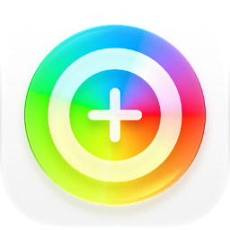

<h1 align="center">
     
    Calibrat  
</h1>

    Native calibration app for Calibrite devices.  

## Features

- Native (Swift + Rust)
- Visual fine-tuning
- Background daemon for ICC restoring on XDR displays

## Supported devices

- Calibrite X-Rite i1 Display Pro
- Calibrite X-Rite i1 Display 2
- Calibrite Display Pro HL

## Trademarks

Calibrite® is a registered trademark of Calibrite LLC. Calibrat is an unofficial product and is not affiliated with Calibrite LLC.
